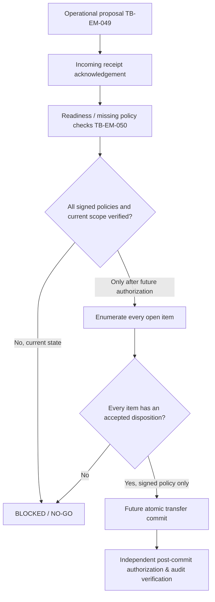

# TB-EM-051 — Real therapist replacement: authorization and technical design only

**Status:** DESIGN CANDIDATE / HUMAN SIGN-OFF REQUIRED / NO-GO. **Implementation authorization:** NOT GRANTED. **Data:** fictional/synthetic only. **Owner decision:** authorizes preparation of this design work unit, **not** the clinical policy choices or release.

**Baseline:** application `main@05cec48b929206cb14371cc36805aa3b0ee4f9fc` (merged PR #113). Existing TB-EM-049 operational proposals and acknowledgement and TB-EM-050 manager readiness are explicitly **non-authorizing**. Both preserve `assignmentChanged:false`, `accessGranted:false`, `clinicalHandover:false`, `released:false`; readiness also enforces `readyForTransfer:false`. `HANDOVER_DEMO` defaults OFF and is denied in staging/production.

## 1. Source hierarchy and gaps

1. **Private source candidate:** `NTinkicht/TheraBridge` V0.9.16 `specs/CB-SRS-001.md`, `CB-SDD-001.md`, `CB-SAD-001.md`, `CB-RMP-001.md`, `specs/validation/V0916_VALIDATION_AND_OPEN_GATES.md`, and `specs/registers/03_Accountable_Owner_Decision_Gates.csv`. These are **review candidates**, not signed implementation authority. The validation report records requirements/API/architecture **NO-GO**. Do not copy or invent approvals from candidate wording.
2. **Private design candidate:** `transferCaseload`, `POST /api/v1/assignments/transfers`. Proposed request: source/target clinician, requestId, explicit assignment IDs+expected versions, a **complete server-checked disposition for every open item**. The duplicate proposed admin transfer path was marked for deletion; do not implement both. Its proposed receipt and `409` stale-revision rules are subject to owner ratification.
3. **Live app:** `POST /api/centers/:centerId/governance/transfer-simulations` creates a simulated draft; `handover-proposals` creates/acknowledges/cancels nonclinical operational records; `handover-proposals/:id/readiness` displays advisory checks. None is an actual transfer API.
4. **Important distinction:** the application also has ordinary manager-facing child assignment and end-assignment operations. They are existing administration capabilities, **not** the approved replacement/clinical-handover workflow. A future design review must prove that users cannot bypass required transfer dispositions or clinical scope controls by chaining those separate operations; do not remove established ordinary assignment behavior in this design-only PR without a validated requirement.

**Source-to-decision mapping:** D10/PFR-CT-01 (departure + open items), OR-15/D-NEW-2 (role matrix), OR-16 (scope/idempotency/denial order), D7 (consent purpose and withdrawal), D-NEW-5 (safeguarding), D4 (guardian restrictions), D1 (signatures). Exact owners and signoff must be supplied by authorized humans. All listed in the machine-readable `docs/policy/TB-EM-051-AUTHORIZATION-GATES.json` register, currently `UNSIGNED`.

## 2. Decisions required before coding an executable transfer

| ID | Required decision | Owner role needed | Current status |
| --- | --- | --- | --- |
| D10 / PFR-CT-01 | Planned vs immediate departure; all open items; disposition choices, affected service scope, effective time, quarantine and reversals | Clinical operations + governance | UNSIGNED |
| OR-15 / D-NEW-2 | Who proposes, clinically authorizes, executes, witnesses, rejects and audits; multi-role segregation | Security + clinical governance | UNSIGNED |
| OR-16 | Auth before idempotency lookup; safe 403/404/409 ordering, replay, unknown-result retry and auditing | Security | UNSIGNED |
| D7 | Purpose-specific consent taxonomy, evidence, expiry, guardian withdrawal handling and whether therapist replacement needs separate grant | Privacy / data protection | UNSIGNED |
| Clinical scope | Which historical plans, reports, notes, observations, recordings and pending items become visible; **do not** transfer document authorship/signature | Records + clinical governance | UNSIGNED |
| D-NEW-5 | Safeguarding lead, restricted case routing, emergency channels and quarantine when a therapist departs | Safeguarding + clinical governance | UNSIGNED |
| D4 | Guardian restriction propagation and no implicit new grant after staff change | Privacy + governance | UNSIGNED |
| D1 | If any transfer-linked signature/co-sign is required, actor-bound signed step-up evidence and immutable record semantics | Security + governance | UNSIGNED |
| Security / audit | Atomicity, lock order, event content minimization, revocation and retention | Security / operations / privacy | UNSIGNED |

**Required human signoff evidence:** decision ID, policy version and its immutable digest, accountable named authority and role, signature/attestation reference, date/time, affected tenants and purpose scope, expiry/revocation behavior, independent security/privacy review. This document is **not a signature collection system** and no placeholder signature may be treated as approval.

## 3. Proposed lifecycle — not an enabled state machine

*This diagram is explanatory only.* `Operational acknowledgement` cannot satisfy clinical acceptance; `readiness` cannot be persisted/replayed as permission. No `AUTHORIZED` or `COMMITTED` transfer state/route should be created in this work unit. Status `CANCELLED` remains terminal in the operational proposal system; do not revive it through a new endpoint.

## 4. Future technical design candidate (requires decisions above)

**Eligibility and scope at commit, not just at preview:**
- Match authenticated actor, active tenant membership and **signed action-specific authorization**. Clinical admin/coordinator has no implicit note/report read. Validate both source and target are active, distinct, correctly qualified for the exact child/service, including any service-specific clinical restriction.
- Require live child/service status, current source assignment ID and version, target qualification and no conflicting replacement; fail closed after suspension/archival, center restriction or specialty revocation.
- Inventory **all** open child/service work, e.g. active sessions, outstanding report/plan reviews, open home-plan tasks, messages and recording/voice artefacts, including known offline/pending/quarantine artifacts. The source candidate proposes a disposition for each: `reassign`, `close` or `quarantine`; these terms are NOT yet owner-approved semantics. Never silently change report authorship/signatures, approvals or immutable evidence provenance.
- For planned departure, resolve approved open-item dispositions before ending the assignment. For immediate suspension, revoke access promptly, quarantine unresolved work and appoint authorized recovery custodians under a signed policy; do not create a data-loss gap or emergency response promise.
- D7, safeguarding, guardian restrictions and subject scope may restrict eligibility. Transfer does not grant a new guardian release, satisfy consent or approve clinical documents.

**Proposed transaction and concurrency boundary:**
- A future command must be **atomic** for the approved assignment switch + required open-item transitions + minimal audit provenance. Define deterministic lock order (center → memberships/roles → child/service/assignments → open items/consent/grants), version/CAS checks, and all-or-nothing rollback. This order is a design proposal, not approved code.
- Re-evaluate authorization **before** looking up an idempotency key or disclosing transfer existence. Cross-center/child IDs must not leak. Duplicate keys and stale assignment versions fail according to signed OR-16 ordering; a network timeout means *unknown outcome*, not automatic failure.
- The target's read scope is permitted only after commit and still requires the ordinary current assignment, specialty, purpose and document-specific checks. Source access ends at the designated effective boundary; audit receipts alone do not keep or grant access. Time-limited coverage and emergency access need separate policy.
- Center event and audit logs contain opaque IDs, status, actor and policy digest only; never raw clinical report content, safeguarding notes, guardian details or security tokens. Protect immutable origin metadata for every authored/signed report and activity.

**Suggested future API design, not implementable yet:**
- Candidate core `POST /api/v1/assignments/transfers` from the private specs; **do not** add an executable route or duplicate admin route until owner alignment with actual app route conventions and OR-15/16.
- Typed request (candidate): `requestId`, `sourceClinicianId`, `targetClinicianId`, `assignments:[{assignmentId,expectedAssignmentVersion}]`, `openItemDispositions:[{itemId,action,toClinicianId?}]`, and signed decision references **only if approved**. The server verifies the complete open-item set; a client `[]` is valid only when server finds zero.
- Response design must distinguish committed from pending/unknown; never echo or leak protected clinical body. Approvals and audit evidence may not be self-asserted by the client.

## 5. Acceptance/denial test matrix (future implementation)

| Scenario | Required future observable result |
| --- | --- |
| Any UNSIGNED gate in development, CI, preview, staging or production | **DENY**, no executable transfer, no assignment mutation, no cross-tenant disclosure |
| Cross-center proposal/assignment ID, unknown child or unrelated clinician | Non-disclosing denial; no resource enumeration |
| Stale source/target scope, archived child, invalid specialty, expired temporary assignment | Deny and keep source/target state unchanged |
| Source suspension or target revocation racing with commit | Serialized; no committed transfer to revoked actor |
| Any unresolved open session, review, plan, message or recording | Deny, require item-specific approved disposition or quarantine |
| Concurrent second transfer or mismatched assignment version | One authoritative commit at most; other gets a safe conflict |
| Missing/withdrawn consent, restricted guardian, safeguarding hold | Fail closed under signed rules; no implicit grant |
| Repeated request ID from an unrelated tenant/actor | Cannot reveal earlier receipt or target data |
| HTTP timeout after commit | Distinguish unknown vs retry; no duplicate assignment or audit |
| Valid fully authorized future transfer | Single atomic assignment transition, provenance/audit, access revocation and **no inherited signing authority** |
| Family or unrelated specialty tries to view unreleased clinical artifacts | 403/404 denial, including stale browser tabs |
| Rollback or interruption mid-commit | Neither partial reassignment nor orphaned open items |

**TB-EM-051 deliverable itself must instead prove all gates remain `UNSIGNED`, all real transfer actions `BLOCKED`, and existing TB-EM-049/050 flags unchanged.** These future positive-path tests are specifications, **not executed acceptance**.

## 6. Exact boundaries, deliverables and exit criteria

**In scope now:** decision register, architectural lifecycle, policy traceability, negative-path test designs, executable CI integrity check for the unsigned policy register, documentation/QA checkpoint and owner review. **Out of scope:** any new real transfer endpoint, mutation, migration, permissions grant, UI approval button, background job, patient record handling, clinical signing, safeguarded family messaging, consent action, hosted configuration or deployment.

Exit from **design slice** only when the exact GitHub commit passes all six application CI jobs, the unsigned-policy contract check passes, reviewers have no unresolved P0–P2, and owner chooses to merge. **That still does not approve real therapist transfers or close Milestone 2's clinical policy dependencies.**

Existing deferred issues [#112](https://github.com/NTinkicht/TheraBridge-Emergent/issues/112) and [#114](https://github.com/NTinkicht/TheraBridge-Emergent/issues/114) remain separate. External hosted QA [#81](https://github.com/NTinkicht/TheraBridge-Emergent/issues/81) is incomplete. **The next executable implementation work unit cannot start until the actual accountable policy owners sign the relevant decisions.**
